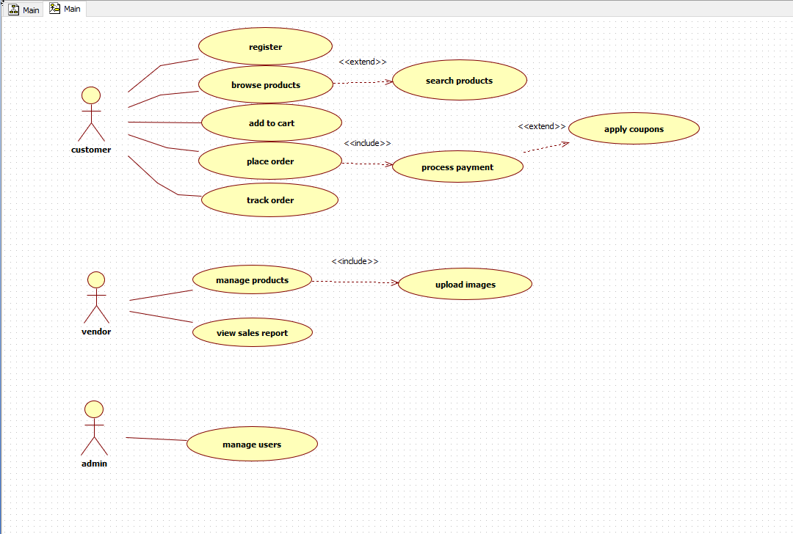
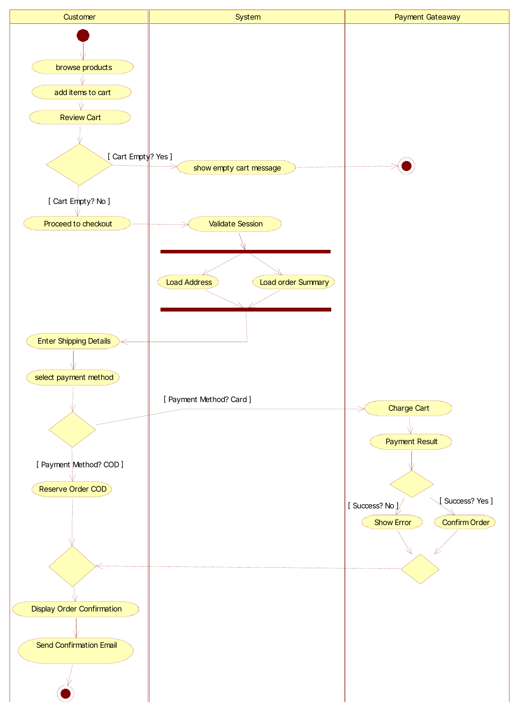
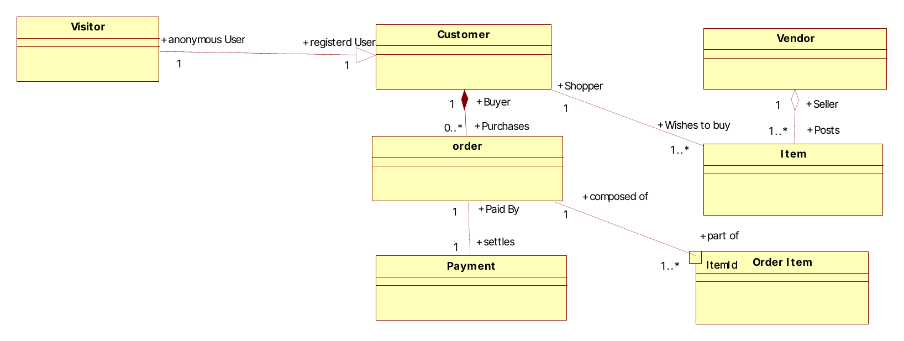
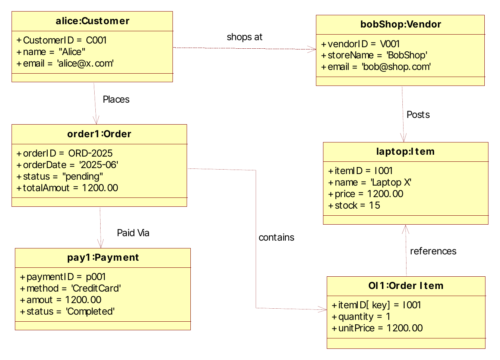
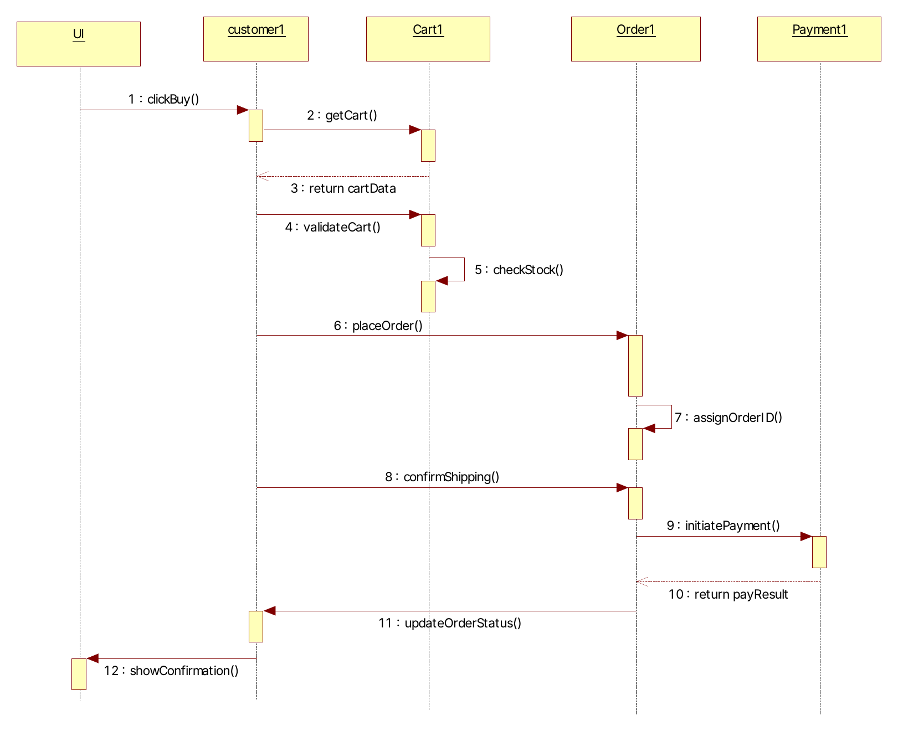

# E-Commerce Portal: Requirements & System Design

Requirements engineering and UML design for a multi-vendor e-commerce portal, built to serve up to **1,000 concurrent users**. It covers the work from a vague idea to measurable requirements, then use cases, and then a full set of structural and behavioural models.

**Actors:** Customer · Vendor · Admin · Payment Gateway

## Contents

1. [Requirements engineering](#1-requirements-engineering)
2. [Use case model](#2-use-case-model)
3. [Activity diagram: Place Order](#3-activity-diagram-place-order)
4. [Class diagram](#4-class-diagram)
5. [Object diagram](#5-object-diagram)
6. [Sequence diagram: Place Order](#6-sequence-diagram-place-order)

---

## 1. Requirements engineering

### From vague to testable

A requirement like *"the system should be fast"* fails every quality check. It doesn't say what operation, what load, or what counts as fast, so it can't be tested. I rewrote it as a measurable non-functional requirement:

> Under a load of up to **1,000 concurrent users**, the portal must return results for any product search query within **2 seconds** for **95% of requests**, verified with automated load-testing tools in a production-equivalent environment.

| Quality | Before | After |
|---|---|---|
| Measurable | ✗ | ✓ 2-second target |
| Testable | ✗ | ✓ 95th-percentile pass/fail |
| Scoped | ✗ | ✓ product search only |
| Load defined | ✗ | ✓ 1,000 concurrent users |

### Requirement classification

| Requirement | Type |
|---|---|
| User authentication | Technical solution |
| Data storage & retrieval | Technical solution |
| Report generator | Business |
| Error handling | Technical solution |
| Card-network compliance | Constraint (regulatory) |
| System response time | Non-functional: performance |
| Password policy | Non-functional: security |
| Consistent UI theme | Non-functional: look & feel |
| Data protection | Non-functional: legal |

### Requirement specification: data storage & retrieval

- **Description:** all application data (items, customers, orders, payments, inventory) is stored in a relational database that supports concurrent reads and writes for 1,000 users without data loss.
- **Fit criteria:**
  1. Any record can be retrieved by primary key in under 1 second under typical load.
  2. Stress testing at 1,000 concurrent users shows no data loss or corruption.
  3. Automated integration tests confirm transactions follow ACID properties.
- **Priority:** High (MoSCoW: *Must have*). Every other feature depends on it.

---

## 2. Use case model

- `<<include>>`: **Place Order** always includes **Process Payment**, and **Manage Products** always includes **Upload Images**.
- `<<extend>>`: **Apply Coupons** is an optional extension of payment, and **Search Products** extends browsing.

### Use case specification: Place Order

| | |
|---|---|
| **Actor** | Customer |
| **Goal** | Buy the items in the cart by providing shipping and payment details, ending in a confirmed order |
| **Preconditions** | Customer is signed in · cart has at least one item · all items are in stock · payment gateway is available |
| **Postconditions** | Order created as *Pending* or *Completed* · stock decremented · confirmation email sent · cart cleared |

**Main success scenario**

1. Customer clicks *Proceed to checkout*.
2. System shows the order summary and shipping form.
3. Customer confirms the shipping address and selects a payment method (card or cash on delivery).
4. Customer clicks *Confirm order*.
5. System validates the input and checks stock.
6. System invokes **Process Payment**, and the gateway authorises it.
7. System creates the order, decrements stock and sends a confirmation email.
8. System shows the confirmation page with the order ID.

---

## 3. Activity diagram: Place Order

Swimlanes for **Customer**, **System** and **Payment Gateway**, covering the empty-cart branch, parallel loading of address and order summary, and the card vs. cash-on-delivery paths.

---

## 4. Class diagram

Domain model showing generalisation (Visitor → Customer), composition (Customer ◆ Order), aggregation (Vendor ◇ Item), a qualified association on Order Item, and multiplicities.

---

## 5. Object diagram

A snapshot of the model at runtime: one customer placing one order for one item from one vendor, paid by credit card.

---

## 6. Sequence diagram: Place Order

Message flow between UI, Customer, Cart, Order and Payment, from *clickBuy()* to *showConfirmation()*.

---

## Skills demonstrated

Requirements elicitation & specification · Non-functional requirements & fit criteria · MoSCoW prioritisation · UML (use case, activity, class, object, sequence) · Domain modelling · Relational data design (ACID)

## Author

**Angelo Dargham**, Computer Science student at the Arab Open University (Lebanon).
Built as part of TM354 Software Engineering.
